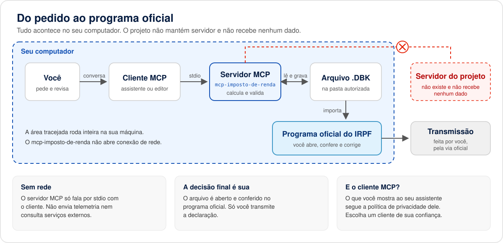
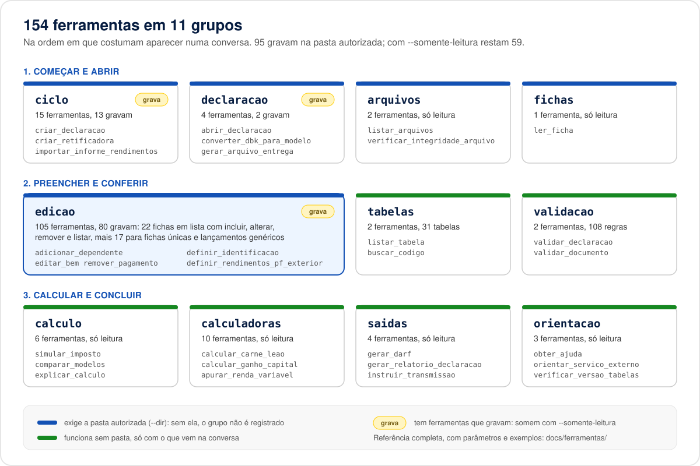
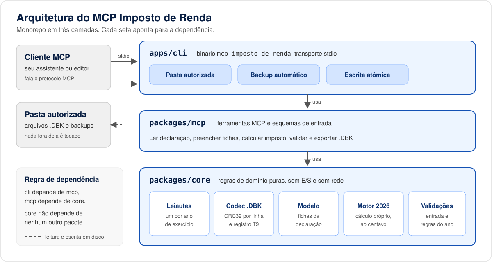
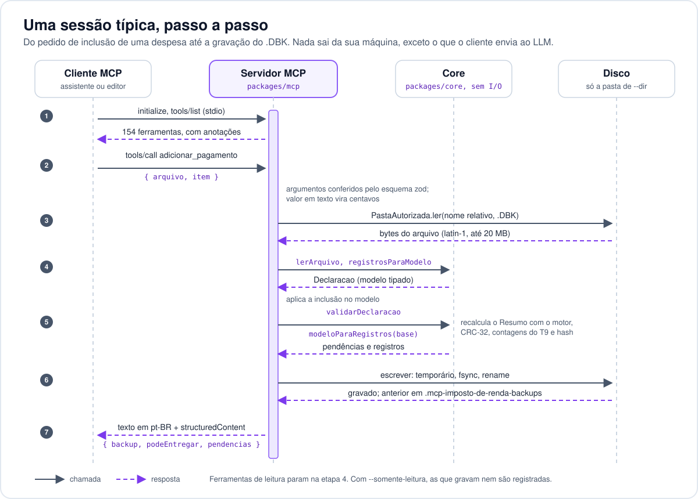
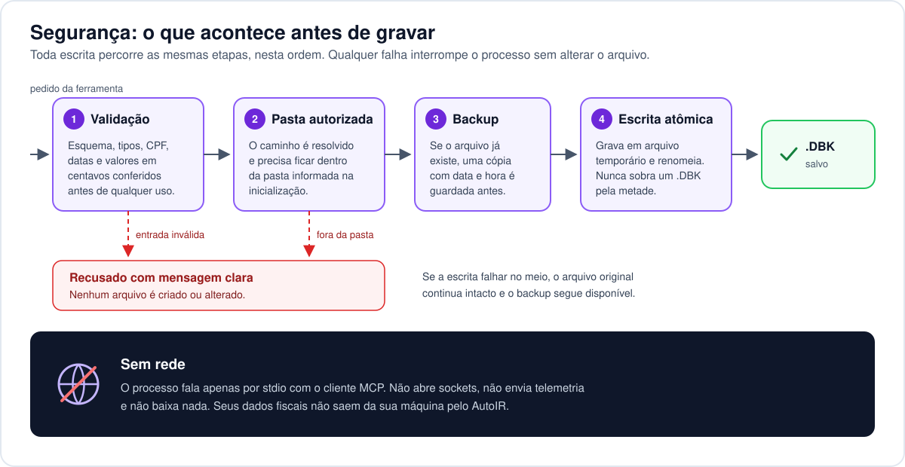
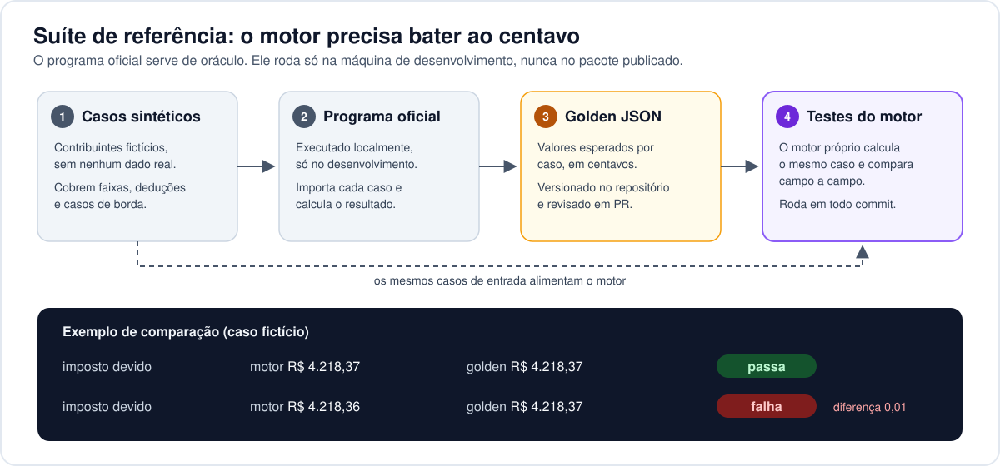
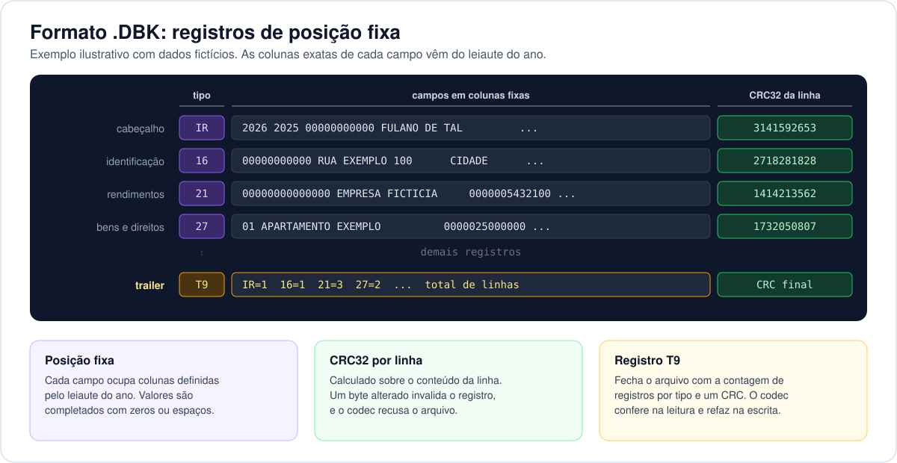

<p align="center">
  <picture>
    <source media="(prefers-color-scheme: dark)" srcset="docs/assets/logo-wordmark-dark.svg">
    
  </picture>
</p>

<p align="center">
  <strong>Servidor MCP 100% local para preparar a declaração do IRPF 2026 com o seu assistente de IA, sem tirar os arquivos da sua máquina.</strong>
</p>

<p align="center">
  <a href="LICENSE"></a>
  
  
  
  <a href="docs/testes.md"></a>
</p>

<p align="center">
  
</p>

O MCP Imposto de Renda é um servidor [MCP](https://modelcontextprotocol.io) (Model Context
Protocol) que roda na sua máquina e conversa com o seu cliente MCP via stdio. Ele lê e grava o
arquivo de cópia de segurança da declaração (`.DBK`) do programa oficial, calcula o imposto nos
modelos completo e simplificado, explica cada conta, aponta pendências e consulta as tabelas de
códigos do exercício. No fim, você restaura o arquivo no programa oficial, confere e transmite por
lá.

> [!WARNING]
> **Leia antes de usar.**
>
> - O MCP Imposto de Renda **não é serviço oficial da Receita Federal** e não tem vínculo com ela
>   nem com qualquer órgão público.
> - Ele **não transmite** declarações e não acessa sistemas do governo. A entrega é sempre feita
>   pelo programa oficial (PGD).
> - Ele não envia nada pela rede. Porém, tudo o que as ferramentas devolvem ao seu cliente MCP
>   (nomes, CPFs, rendimentos, bens) **chega ao provedor de LLM que você escolheu** nesse cliente.
>   Leia a política de privacidade desse provedor e decida o que compartilhar.
> - Não há garantia de exatidão. A responsabilidade pela declaração é sempre do contribuinte.

## Sumário

- [Por que usar](#por-que-usar)
- [Como é na prática](#como-é-na-prática)
- [Início rápido](#início-rápido)
- [Clientes compatíveis](#clientes-compatíveis)
- [Destaques](#destaques)
- [Ferramentas](#ferramentas)
- [Declarações de exemplo](#declarações-de-exemplo)
- [Arquitetura](#arquitetura)
- [Segurança](#segurança)
- [Privacidade e LGPD](#privacidade-e-lgpd)
- [Precisão](#precisão)
- [Limitações conhecidas](#limitações-conhecidas)
- [Perguntas frequentes](#perguntas-frequentes)
- [Roadmap](#roadmap)
- [Documentação](#documentação)
- [Contribuição](#contribuição)
- [Licença](#licença)
- [Aviso legal](#aviso-legal)

## Por que usar

- **Você conversa, o assistente preenche.** Cole o informe de rendimentos, descreva as despesas e
  peça para lançar. O servidor acha os códigos certos, grava cada ficha e devolve as pendências na
  mesma resposta.
- **Cada conta explicada.** `explicar_calculo` mostra a memória de cálculo linha a linha, com a lei
  aplicada em cada passo: tetos, limites por dependente, truncamento de centavos, comparação entre
  os modelos.
- **Arquivo do programa oficial, não um formato paralelo.** O resultado é um `.DBK` que o programa
  da Receita restaura com **Ferramentas > Cópia de Segurança > Restaurar**. Dá para começar do zero
  ou partir de uma declaração já iniciada no programa.
- **Conferido contra o programa oficial.** O motor reproduz ao centavo 48 casos de referência
  gerados pelo próprio programa, e o codec regrava byte a byte os arquivos que ele grava.
- **Seus arquivos ficam com você.** Sem servidor, conta, telemetria ou conexão de rede. O processo
  só enxerga a pasta que você autorizar e guarda cópia de cada versão antes de gravar.
- **Software livre e auditável.** AGPL-3.0, em TypeScript, sem nenhum código da Receita Federal.



## Como é na prática

Trecho real do [exemplo 1](exemplos/01-assalariado-simples/README.md), com as respostas exatas do
servidor. Todos os dados são fictícios; a conversa inteira está em
[`conversa.md`](exemplos/01-assalariado-simples/conversa.md).

> **Você:** Este é o meu informe de rendimentos da empresa: rendimentos tributáveis R$ 96.000,00,
> previdência oficial R$ 9.840,00, imposto retido R$ 11.400,00, 13º salário R$ 8.000,00 com IRRF
> de R$ 652,30.

O assistente chama `adicionar_rendimento_pj` com o CNPJ da fonte e os valores, e o servidor
responde:

```text
Rendimentos Tributáveis Recebidos de Pessoa Jurídica: item 1 incluído. Gravado 10121874206-IRPF-A-2026-2025-ORIGI.DBK (6 registros).
Cópia do conteúdo anterior: .mcp-imposto-de-renda-backups/10121874206-IRPF-A-2026-2025-ORIGI.DBK.20260410T120000Z.bak.
Controles: conferem.
Sem erros impeditivos; 0 aviso(s).
```

> **Você:** Qual modelo é melhor para mim? Me mostre a conta.

`definir_opcao_tributacao` grava o modelo mais vantajoso e `explicar_calculo` devolve a memória de
cálculo (trecho):

```text
Modelo simplificado:
1. Rendimentos tributáveis: R$ 96.000,00 [Mesma soma do modelo completo.]
2. Desconto simplificado: 20% de R$ 96.000,00 = R$ 19.200,00, limitado a R$ 16.754,34; desconto R$ 16.754,34 [Lei 9.250/1995, art. 10, ...]
3. Base de cálculo: R$ 96.000,00 - R$ 16.754,34 = R$ 79.245,66
4. Imposto pela tabela anual (alíquota de 27,50% menos parcela a deduzir de R$ 10.853,78): R$ 10.938,77
...
13. Imposto a restituir: R$ 11.400,00 - R$ 10.938,77, se positivo = R$ 461,23 [Lei 9.250/1995, art. 13.]
```

> **Você:** Quero receber a restituição por Pix na chave do meu CPF. Confira o arquivo e me diga
> como entregar.

O servidor grava a opção, confere os controles de integridade (`verificar_integridade_arquivo`) e
devolve o passo a passo para restaurar e transmitir no programa oficial
(`instruir_transmissao`).

## Início rápido

**Requisito:** Node.js 22 ou superior. A versão 0.1.0 ainda não foi publicada no npm; até lá,
instale a partir do código (o pnpm vem com `corepack enable`).

**1. Instale e compile.**

```sh
git clone https://github.com/ALASTecnology/mcp-imposto-de-renda.git
cd mcp-imposto-de-renda
corepack enable && pnpm install && pnpm build
node apps/cli/dist/index.js --versao
```

**2. Crie uma pasta só para a declaração e registre o servidor no seu cliente.** No Claude
Desktop, por exemplo, em `claude_desktop_config.json`:

```json
{
  "mcpServers": {
    "mcp-imposto-de-renda": {
      "command": "node",
      "args": [
        "/caminho/para/mcp-imposto-de-renda/apps/cli/dist/index.js",
        "--dir",
        "/Users/voce/Documentos/IR-2026"
      ]
    }
  }
}
```

Depois da publicação no npm, o comando vira `npx -y mcp-imposto-de-renda --dir <pasta>`. Opções
úteis:

| Opção | Efeito |
| --- | --- |
| `--perfil essencial` | 78 ferramentas: a declaração inteira, sem os atalhos repetidos por ficha. Use em clientes com limite de ferramentas (VS Code: 128; Windsurf: 100). |
| `--perfil consulta` | 37 ferramentas: só leitura e cálculo, nada grava. |
| `--grupos` e `--sem-grupos` | Expõem ou tiram grupos inteiros, por nome. |
| `--somente-leitura` | Desliga todas as ferramentas que gravam arquivos. |

**3. Converse.** Peça "Vamos preparar a minha declaração do IRPF 2026" ou acione o prompt
`preparar_declaracao`. Para partir do que você já tem, grave a cópia de segurança no programa
oficial dentro da pasta e peça para abrir o `.DBK`.

Mais detalhes em [instalação](docs/guias/instalacao.md), no
[tutorial da primeira declaração](docs/guias/primeira-declaracao.md) e em
[solução de problemas](docs/guias/solucao-de-problemas.md).

## Clientes compatíveis

O servidor funciona em qualquer cliente que inicie servidores MCP locais por stdio. O
[índice de clientes](docs/guias/clientes-mcp.md) traz o nível de suporte e um guia de configuração
para cada um, inclusive os que exigem ponte local ou não são suportados.

| Cliente | Suporte | Guia |
| --- | --- | --- |
| Claude Desktop | Completo | [claude-desktop.md](docs/guias/clientes/claude-desktop.md) |
| Claude Code | Completo | [claude-code.md](docs/guias/clientes/claude-code.md) |
| ChatGPT (aplicativo de desktop) e OpenAI Codex | Completo | [chatgpt.md](docs/guias/clientes/chatgpt.md), [codex.md](docs/guias/clientes/codex.md) |
| Gemini CLI e Antigravity | Completo | [gemini-cli.md](docs/guias/clientes/gemini-cli.md) |
| GitHub Copilot no VS Code | Completo, com limite de ferramentas do cliente | [vscode-copilot.md](docs/guias/clientes/vscode-copilot.md) |
| Cursor | Completo | [cursor.md](docs/guias/clientes/cursor.md) |
| Windsurf | Completo, com limite de ferramentas do cliente | [windsurf.md](docs/guias/clientes/windsurf.md) |
| Zed, JetBrains, Cline, Continue, goose, Kiro | Completo | [índice](docs/guias/clientes-mcp.md#clientes) |
| LM Studio e Ollama (modelo local) | Completo | [lm-studio.md](docs/guias/clientes/lm-studio.md), [ollama.md](docs/guias/clientes/ollama.md) |
| Open WebUI | Com ponte local | [open-webui.md](docs/guias/clientes/open-webui.md) |

Com um modelo rodando na sua máquina (LM Studio, Ollama), nada da declaração sai do computador.

## Destaques

Números conferidos no código desta versão (`pnpm docs:catalogo` e `pnpm test`).

| Indicador | Valor | Onde conferir |
| --- | --- | --- |
| Ferramentas MCP | **154** em 11 grupos; 95 gravam, 59 com `--somente-leitura`; perfis `essencial` (78) e `consulta` (37) | [referência das ferramentas](docs/ferramentas/README.md) |
| Casos de referência (golden) reproduzidos ao centavo | **48 de 48** | [`packages/core/test/golden/2026`](packages/core/test/golden/2026), [regras do IRPF 2026](docs/regras/irpf-2026.md) |
| Arquivos do programa oficial relidos e regravados byte a byte | **96** (48 `.DBK` e 48 `.DEC`) | [`packages/core/test/fixtures/dbk/2026`](packages/core/test/fixtures/dbk/2026) |
| Tipos de registro do `.DBK` convertidos para o modelo | **57**, em 26 fichas | [formato do DBK](docs/formato-dbk.md) |
| Regras de validação | **108** (81 erros e 27 avisos) | [`packages/core/src/validate`](packages/core/src/validate) |
| Tabelas de códigos do exercício | **31** | [tabelas](docs/mapeamento/tabelas/README.md) |
| Funções do programa oficial mapeadas | **416**: 328 atendidas, 76 parciais, 12 sem equivalente | [matriz de cobertura](docs/mapeamento/matriz-cobertura.md) |
| Testes automatizados | **mais de 1.100 testes**, em Vitest (o total exato sai de `pnpm test`) | [estratégia de testes](docs/testes.md) |
| Declarações de exemplo regeneradas a cada teste | **4** | [exemplos](exemplos/README.md) |
| Chamadas de rede | **nenhuma** (verificado por teste) | [segurança](docs/seguranca.md) |

## Ferramentas



| Grupo | Ferramentas | O que cobre |
| --- | --- | --- |
| [`ciclo`](docs/ferramentas/ciclo.md) | 15 | Criar, retificar, copiar, restaurar e excluir; opção de tributação, conta e quotas; importação de informes colados |
| [`declaracao`](docs/ferramentas/declaracao.md) | 4 | Abrir o `.DBK`/`.DEC`, converter para o modelo JSON e de volta, gerar o `.DEC` de conferência |
| [`arquivos`](docs/ferramentas/arquivos.md) | 2 | Listar a pasta e conferir os controles de integridade |
| [`fichas`](docs/ferramentas/fichas.md) | 1 | Ler uma ficha isolada |
| [`edicao`](docs/ferramentas/edicao.md) | 105 | Incluir, alterar, remover e listar em 22 fichas em lista, mais as fichas únicas |
| [`tabelas`](docs/ferramentas/tabelas.md) | 2 | Consultar as 31 tabelas de códigos |
| [`validacao`](docs/ferramentas/validacao.md) | 2 | Pendências da declaração e dígitos de CPF e CNPJ |
| [`calculo`](docs/ferramentas/calculo.md) | 6 | Simular, comparar modelos, explicar o cálculo, quotas, multa e parâmetros |
| [`calculadoras`](docs/ferramentas/calculadoras.md) | 10 | Carnê-leão, RRA, preço médio, renda variável, ganho de capital, acréscimos, residência, obrigatoriedade, câmbio |
| [`saidas`](docs/ferramentas/saidas.md) | 4 | Dados do Darf, relatório, comunicação de saída e passo a passo da transmissão |
| [`orientacao`](docs/ferramentas/orientacao.md) | 3 | Ajuda do programa e serviços que só existem fora do servidor |

A [referência das ferramentas](docs/ferramentas/README.md) traz, para cada uma, os parâmetros com
tipo e obrigatoriedade, as anotações MCP, um exemplo real de chamada e resposta e as funções
correspondentes do programa oficial. Todas são locais (`openWorldHint: false`); as que gravam são
anunciadas com `destructiveHint: true`, para o cliente pedir confirmação.

**Valores monetários na entrada:** texto é sempre em **reais** no formato brasileiro
(`"1.234,56"`); número inteiro é sempre em **centavos** (`123456` = R$ 1.234,56). No modelo JSON da
declaração, os valores são inteiros em centavos, as datas em `AAAA-MM-DD` e CPF/CNPJ só com dígitos.

| Tipo | Nome | Para que serve |
| --- | --- | --- |
| Prompt | `preparar_declaracao` | Roteiro guiado de coleta dos informes e preenchimento das fichas, com simulação a cada etapa. Argumento opcional `arquivo`. |
| Prompt | `revisar_malha_fina` | Revisão em busca de pendências e inconsistências que costumam levar à malha fina. Argumento opcional `arquivo`. |
| Recurso | `mcp-imposto-de-renda://aviso-legal` | Limites do servidor: não é serviço oficial, dados vão ao provedor de LLM, revisar e transmitir pelo programa oficial. |

<details>
<summary><strong>Catálogo resumido das 154 ferramentas</strong> (gerado a partir do <code>tools/list</code>)</summary>

<!-- catalogo:inicio -->
Gerado a partir de `tools/list` do servidor: **154 ferramentas** em 11 grupos, 95 delas gravam na pasta autorizada (e somem com `--somente-leitura`, que deixa 59).

### calculo

Simulação do imposto, comparação de modelos, quotas, multa e parâmetros.

| Ferramenta | O que faz | Grava? |
| --- | --- | --- |
| `simular_imposto` | Calcula o imposto da declaração (exercício 2026, ano-calendário 2025) nos modelos completo e simplificado e indica o mais vantajoso, com saldo a pagar ou a restituir. | não |
| `comparar_modelos` | Compara as deduções legais (modelo completo) com o desconto simplificado de 20% (limitado a R$ 16.754,34) e mostra a diferença de resultado. | não |
| `explicar_calculo` | Devolve a memória de cálculo linha a linha, em pt-BR, com a conta feita e a regra legal aplicada em cada passo (rendimentos, deduções, base, tabela progressiva, incentivos, imposto pago, saldo). | não |
| `calcular_quotas` | Divide o saldo de imposto a pagar em até 8 quotas (mínimo R$ 50,00 cada; abaixo de R$ 100,00 só quota única), com vencimentos e juros Selic a partir da 2ª quota. | não |
| `calcular_multa_atraso` | Multa por atraso (MAED): 1% ao mês-calendário ou fração sobre o imposto devido, mínimo R$ 165,74 e máximo 20%. | não |
| `consultar_parametros` | Tabela progressiva anual, limites de dedução, desconto simplificado, prazos e quotas do exercício, com as fontes oficiais. | não |

### declaracao

Abrir, converter e gravar o arquivo da declaração (DBK/DEC). Exige `--dir`.

| Ferramenta | O que faz | Grava? |
| --- | --- | --- |
| `abrir_declaracao` | Lê um DBK ou DEC da pasta autorizada e devolve um resumo: contribuinte, tipo de declaração, quantidade de itens e totais por ficha, registros por tipo e integridade dos controles. | não |
| `converter_dbk_para_modelo` | Converte um DBK/DEC da pasta autorizada no modelo JSON do MCP Imposto de Renda (identificação, dependentes, rendimentos de PJ, pagamentos, bens e dívidas). | não |
| `converter_modelo_para_dbk` | Grava a declaração (modelo JSON) em um arquivo .DBK da pasta autorizada. | **sim** |
| `gerar_arquivo_entrega` | Gera o arquivo de entrega (.DEC) a partir de um .DBK da pasta autorizada, montando os registros do recibo (HR, DR e R9) e recalculando os controles, como o programa oficial grava. | **sim** |

### fichas

Consulta de fichas da declaração. Exige `--dir`.

| Ferramenta | O que faz | Grava? |
| --- | --- | --- |
| `ler_ficha` | Devolve só uma ficha (identificação, dependentes, rendimentos de PJ, pagamentos, bens ou dívidas) de um DBK/DEC/JSON da pasta autorizada, no formato do modelo (centavos). | não |

### edicao

Inclusão, edição, remoção e listagem de lançamentos de cada ficha da declaração. Exige `--dir`.

Fichas em lista: cada uma tem quatro ferramentas. As de inclusão, alteração e remoção validam a declaração e gravam o `.DBK` com cópia de segurança, devolvendo as pendências.

| Ficha | Incluir | Alterar | Remover | Listar |
| --- | --- | --- | --- | --- |
| Dependentes | `adicionar_dependente` | `editar_dependente` | `remover_dependente` | `listar_dependentes` |
| Alimentandos | `adicionar_alimentando` | `editar_alimentando` | `remover_alimentando` | `listar_alimentandos` |
| Rendimentos Tributáveis Recebidos de Pessoa Jurídica | `adicionar_rendimento_pj` | `editar_rendimento_pj` | `remover_rendimento_pj` | `listar_rendimentos_pj` |
| Rendimentos Isentos e Não Tributáveis | `adicionar_rendimento_isento` | `editar_rendimento_isento` | `remover_rendimento_isento` | `listar_rendimentos_isentos` |
| Rendimentos Sujeitos à Tributação Exclusiva/Definitiva | `adicionar_rendimento_exclusivo` | `editar_rendimento_exclusivo` | `remover_rendimento_exclusivo` | `listar_rendimentos_exclusivos` |
| Rendimentos Tributáveis de PJ (Exigibilidade Suspensa) | `adicionar_rendimento_exigibilidade_suspensa` | `editar_rendimento_exigibilidade_suspensa` | `remover_rendimento_exigibilidade_suspensa` | `listar_rendimentos_exigibilidade_suspensa` |
| Rendimentos Recebidos Acumuladamente | `adicionar_rra` | `editar_rra` | `remover_rra` | `listar_rra` |
| Pagamentos Efetuados | `adicionar_pagamento` | `editar_pagamento` | `remover_pagamento` | `listar_pagamentos` |
| Doações Efetuadas | `adicionar_doacao` | `editar_doacao` | `remover_doacao` | `listar_doacoes` |
| Doações Diretamente na Declaração | `adicionar_doacao_direta_declaracao` | `editar_doacao_direta_declaracao` | `remover_doacao_direta_declaracao` | `listar_doacoes_diretas_declaracao` |
| Bens e Direitos | `adicionar_bem` | `editar_bem` | `remover_bem` | `listar_bens` |
| Dívidas e Ônus Reais | `adicionar_divida` | `editar_divida` | `remover_divida` | `listar_dividas` |
| Herdeiros/Meeiro | `adicionar_herdeiro` | `editar_herdeiro` | `remover_herdeiro` | `listar_herdeiros` |
| Doações a Partidos Políticos e Candidatos | `adicionar_doacao_eleitoral` | `editar_doacao_eleitoral` | `remover_doacao_eleitoral` | `listar_doacoes_eleitorais` |
| Demonstrativo de Ganhos de Capital | `adicionar_ganho_capital` | `editar_ganho_capital` | `remover_ganho_capital` | `listar_ganhos_capital` |
| Renda Variável: Operações Comuns/Day-Trade | `adicionar_renda_variavel` | `editar_renda_variavel` | `remover_renda_variavel` | `listar_renda_variavel` |
| Renda Variável: Operações em FII ou Fiagro | `adicionar_fii_fiagro` | `editar_fii_fiagro` | `remover_fii_fiagro` | `listar_fii_fiagro` |
| Demonstrativo da Atividade Rural: Imóveis explorados | `adicionar_imovel_rural` | `editar_imovel_rural` | `remover_imovel_rural` | `listar_imoveis_rurais` |
| Demonstrativo da Atividade Rural: Receitas e despesas | `adicionar_receita_despesa_rural` | `editar_receita_despesa_rural` | `remover_receita_despesa_rural` | `listar_receitas_despesas_rurais` |
| Demonstrativo da Atividade Rural: Movimentação do rebanho | `adicionar_rebanho` | `editar_rebanho` | `remover_rebanho` | `listar_rebanhos` |
| Demonstrativo da Atividade Rural: Bens da atividade rural | `adicionar_bem_rural` | `editar_bem_rural` | `remover_bem_rural` | `listar_bens_rurais` |
| Demonstrativo da Atividade Rural: Dívidas vinculadas à atividade rural | `adicionar_divida_rural` | `editar_divida_rural` | `remover_divida_rural` | `listar_dividas_rurais` |

Demais ferramentas do grupo:

| Ferramenta | O que faz | Grava? |
| --- | --- | --- |
| `listar_fichas` | Mostra todas as fichas do modelo com a quantidade de itens preenchidos em um DBK/DEC, e quais estão em lista, consultáveis por listar_lancamentos e editáveis pelas ferramentas genéricas de lançamento. | não |
| `listar_lancamentos` | Lista os itens de qualquer ficha em lista, com a posição de cada um. | não |
| `editar_lancamento` | Altera um item de qualquer ficha em lista (campos mesclados; null remove), valida e grava com cópia de segurança. | **sim** |
| `remover_lancamento` | Remove um item de qualquer ficha em lista, valida e grava com cópia de segurança (dependente ou alimentando com vínculos exige cascata: true). | **sim** |
| `definir_identificacao` | Mescla os campos informados na ficha Identificação do Contribuinte (nome, nascimento, endereço, ocupação, cônjuge, tipo de declaração, retorno ao país, NIT). | **sim** |
| `definir_rendimentos_pf_exterior` | Lança os valores mensais (carnê-leão) de uma pessoa: informe 'mes' e 'valores' (coluna: valor) para um mês, ou 'colunas' (coluna: 12 valores) para o ano. | **sim** |
| `definir_renda_variavel` | Grava o mês (comuns e day-trade por mercado, IRRF de day-trade, IRRF da Lei 11.033 e imposto pago) do titular ou de um dependente; também aceita os valores de janeiro vindos de anos anteriores. | **sim** |
| `definir_fii_fiagro` | Grava o mês das operações com cotas de FII ou Fiagro (resultado líquido, imposto retido e imposto pago) do titular ou de um dependente; 'prejuizo_anterior' informa o prejuízo vindo de anos anteriores. | **sim** |
| `definir_espolio` | Grava a ficha Espólio: 'tipo' ajuste (declaração de ajuste com natureza 81: sobrepartilha e inventariante) ou final (Declaração Final de Espólio: ano do óbito, modalidade, bens a inventariar, decisão judicial ou escritura, inventariante e cônjuge). | **sim** |
| `definir_saida_definitiva` | Grava a ficha Saída Definitiva do País (campos mesclados aos atuais; 'remover': true apaga a ficha). | **sim** |
| `definir_informacoes_conjuge` | Grava a ficha Informações do Cônjuge (campos mesclados aos atuais; 'remover': true apaga a ficha). | **sim** |
| `definir_receitas_despesas_rurais` | Grava as receitas e despesas da atividade rural: na aba brasil, itens { mes, receitaBruta, despesa }; na aba exterior, itens { pais, receitaBrutaMoedaOriginal, despesaMoedaOriginal, resultadoDolar }. | **sim** |
| `definir_apuracao_rural` | Grava os campos digitados da apuração da atividade rural (prejuízo anterior, opção resultado ou limite20, compensação, adiantamentos, limite de 20% no exterior). | **sim** |
| `definir_rebanho` | Grava a movimentação de uma espécie do rebanho (1 a 4 conforme o programa, 5 = outros): estoque inicial, aquisições, nascimentos, consumo e perdas, vendas. | **sim** |
| `definir_partilha_bem` | Na Declaração Final de Espólio, define para um bem (posição em listar_lancamentos com ficha 'bens') se ainda está a inventariar, a situação na data da partilha, o valor de transferência e os percentuais por herdeiro (centésimos: 100,00% = 10000; herdeiros cadastrados em adicionar_herdeiro). | **sim** |
| `aplicar_caso_especial_bem` | Aplica a um bem (posição em listar_lancamentos com ficha 'bens') um caso especial: usufruto (com os CPF/CNPJ dos proprietários ou usufrutuários), bem a inventariar, atualização pela Lei 14.973/2024 ou criptoativo em custodiante; 'desfazer': true desmarca. | **sim** |
| `buscar_nome_por_documento` | Procura, nos DBK/DEC da pasta autorizada, o nome já informado para um CPF ou CNPJ (fontes pagadoras, dependentes, beneficiários de pagamentos e doações). | não |

### ciclo

Ciclo de vida da declaração (criar, retificar, excluir), opções do Resumo e importações. Exige `--dir`.

| Ferramenta | O que faz | Grava? |
| --- | --- | --- |
| `criar_declaracao` | Cria um DBK novo na pasta autorizada a partir da identificação do contribuinte (formato do modelo) e da opção de tributação. | **sim** |
| `criar_retificadora` | Marca a declaração como retificadora com o número do recibo (12 dígitos) da declaração a retificar e grava em um novo DBK (padrão: CPF-IRPF-A-2026-2025-RETIF.DBK), preservando o restante. | **sim** |
| `registrar_recibo` | Guarda o número do recibo (12 dígitos) que o programa oficial mostrou ao transmitir a declaração, num arquivo <declaração>.recibo.json ao lado do DBK/DEC, para preencher uma futura retificadora (criar_retificadora sem 'recibo'). | **sim** |
| `excluir_declaracao` | Remove um DBK ou DEC da pasta autorizada, guardando antes uma cópia em .mcp-imposto-de-renda-backups. | **sim** |
| `gravar_copia_seguranca` | Copia um DBK ou DEC da pasta para outro .DBK (um DEC vira DBK sem o recibo, com os controles refeitos). | **sim** |
| `listar_copias_seguranca` | Lista as cópias automáticas guardadas em .mcp-imposto-de-renda-backups (feitas antes de sobrescrever ou excluir), da mais recente para a mais antiga. | não |
| `restaurar_copia_seguranca` | Restaura uma cópia de .mcp-imposto-de-renda-backups (nome de listar_copias_seguranca) sobre um .DBK da pasta (padrão: o arquivo de origem; cópia de um .DEC exige arquivo_destino .DBK). | **sim** |
| `definir_opcao_tributacao` | Escolhe deduções legais (completa) ou desconto simplificado, preservando as deduções informadas, e devolve a comparação dos dois modelos com a recomendação. | **sim** |
| `definir_informacoes_bancarias` | Grava a conta para restituição ou débito (banco, agência sem DV, conta, DV, tipo e operação da Caixa), Pix pela chave CPF, número de quotas (1 a 8) e débito automático, validando banco, agência, conta e DV pela regra de cada banco. | **sim** |
| `definir_imposto_pago` | Grava as linhas digitadas da ficha Imposto Pago/Retido: imposto complementar (Darf 0246), imposto pago no exterior e imposto retido na fonte da Lei 11.033/2004. | **sim** |
| `repetir_valores_bens` | Copia a situação em 31/12/2024 para 31/12/2025 nos bens escolhidos (posições de listar_lancamentos com ficha 'bens') ou, sem 'indices', em todos os bens com situação atual zerada; forcar: true copia mesmo quando já há valor. | **sim** |
| `importar_informe_rendimentos` | Lança na declaração o comprovante de rendimentos de PJ colado pelo usuário, em texto ou JSON (sem OCR e sem rede): fonte e CNPJ, quadro 3 (rendimentos, previdência oficial, IRRF), quadro 4 (isentos como parcela de 65 anos, indenizações, lucros), quadro 5 (13º e IRRF do 13º, PLR, aplicações) e plano de saúde do quadro 7. | **sim** |
| `importar_informe_plano_saude` | Lança em Pagamentos Efetuados (código 26) o informe de plano de saúde colado em texto ou JSON: operadora (CNPJ e nome), valor pago por beneficiário e reembolsos. | **sim** |
| `ler_informe` | Lê o comprovante de rendimentos de PJ colado em 'texto' ou num arquivo .txt da pasta autorizada e devolve os campos extraídos por regras fixas (fonte e CNPJ, rendimentos, previdência oficial, IRRF, 13º e IRRF do 13º, isentos e exclusivos), sem gravar nada, sem OCR e sem rede. | não |
| `transferir_excedente_isencao_65` | Soma, por beneficiário com 65 anos ou mais em 2025 (contando a partir do mês em que completa 65), a parcela isenta de aposentadoria (isento código 10) de todas as fontes, aplica o limite de R$ 1.903,98 por mês mais o 13º e transfere o excedente para os Rendimentos Tributáveis de PJ da mesma fonte, como a pergunta do programa. | **sim** |

### validacao

Validação de CPF/CNPJ e pendências da declaração.

| Ferramenta | O que faz | Grava? |
| --- | --- | --- |
| `validar_documento` | Confere os dígitos verificadores de um CPF (11 dígitos) ou CNPJ (14 dígitos). | não |
| `validar_declaracao` | Aplica as regras de consistência equivalentes às críticas do programa oficial e lista as pendências: 'erro' impede a entrega, 'aviso' indica risco de malha fina. | não |

### tabelas

Tabelas de códigos do programa (dependentes, pagamentos, bens, municípios...).

| Ferramenta | O que faz | Grava? |
| --- | --- | --- |
| `listar_tabela` | Lista as entradas de uma tabela de códigos do exercício 2026, com filtro opcional por texto (sem diferenciar acentos) e paginação. | não |
| `buscar_codigo` | Busca um código exato numa tabela do exercício 2026. | não |

### arquivos

Arquivos da pasta autorizada. Exige `--dir`.

| Ferramenta | O que faz | Grava? |
| --- | --- | --- |
| `listar_arquivos` | Lista os arquivos .DBK, .DEC, .json e .txt da pasta autorizada (sem subpastas, ocultos ou links). | não |
| `verificar_integridade_arquivo` | Confere os controles do arquivo: número de controle (CRC-32) de cada registro, contagens do registro T9 e hash do header. | não |

### saidas

Etapa final: dados do Darf e passo a passo para transmitir pelo programa oficial.

| Ferramenta | O que faz | Grava? |
| --- | --- | --- |
| `gerar_darf` | Calcula os dados do Darf (código de receita, período de apuração, vencimentos e valores de cada quota, juros Selic das quotas e, se informada a data de pagamento após o vencimento, multa de 0,33% ao dia até 20% e juros de mora). | não |
| `instruir_transmissao` | Gera o passo a passo e o checklist para concluir no programa oficial da declaração 2026: restaurar o DBK gravado pelo MCP Imposto de Renda, verificar pendências, conferir o Resumo, transmitir com ou sem certificado digital, guardar o recibo e pagar o Darf. | não |
| `gerar_relatorio_declaracao` | Monta um relatório em Markdown da declaração (identificação, fichas preenchidas, totais e resultado simulado) para conferência. | não |
| `gerar_comunicacao_saida` | Gera o texto da comunicação de saída definitiva do país, uma por fonte pagadora de rendimentos de PJ, a partir da ficha Saída Definitiva. | não |

### calculadoras

Calculadoras auxiliares offline: renda variável, preço médio, carnê-leão, RRA, ganho de capital e acréscimos.

| Ferramenta | O que faz | Grava? |
| --- | --- | --- |
| `calcular_carne_leao` | Calcula o carnê-leão (Darf 0190) de um mês de 2025 pela tabela progressiva mensal vigente no mês (janeiro a abril pela Lei 14.848/2024; maio a dezembro pela Lei 15.191/2025), com as deduções de previdência oficial, dependentes (R$ 189,59 cada), pensão e livro-caixa, ou o desconto simplificado mensal quando mais vantajoso. | não |
| `calcular_rra` | Calcula o imposto do RRA pela tabela progressiva acumulada (tabela mensal do mês do recebimento vezes o número de meses, art. | não |
| `calcular_preco_medio` | Calcula o custo médio ponderado por ativo e o resultado de cada venda a partir das notas de corretagem (compras e vendas com custos), separando day-trade (compra e venda do mesmo ativo no mesmo dia), para preencher a Renda Variável. | não |
| `apurar_renda_variavel` | Apura o imposto mensal sobre ganhos líquidos: operações comuns 15%, day-trade 20%, FII e Fiagro 20%, com compensação de prejuízos separada por tipo, compensação de IR na fonte (day-trade e Lei 11.033/2004), isenção de ganhos com ações à vista quando as vendas do mês não passam de R$ 20.000,00 e Darf 6015 com vencimento no último dia útil do mês seguinte. | não |
| `calcular_ganho_capital` | Simulador de orientação para alienação de imóvel, móvel ou participação: ganho = valor de alienação menos corretagem e custo; reduções da Lei 7.713/1988 (aquisição até 1988) e fatores FR1/FR2 da Lei 11.196/2005 para imóveis; isenções do único imóvel até R$ 440.000,00, da reaplicação em outro imóvel residencial e de pequeno valor; alíquotas de 15%, 17,5%, 20% e 22,5% por faixa. | não |
| `atualizar_custo_bem` | Orientação e cálculo da atualização do custo de bem ou direito com os valores informados pelo usuário: 'ufir' (bens adquiridos até 31/12/1995, quantidade de UFIR vezes R$ 0,8287, Lei 9.249/1995, art. | não |
| `calcular_acrescimos_moratorios` | Calcula a multa de mora (0,33% por dia de atraso, limitada a 20%) e os juros (Selic acumulada informada mais 1% no mês do pagamento) de qualquer débito federal vencido. | não |
| `calcular_condicao_residencia` | Determina a data em que a pessoa passa a residente ou não residente no Brasil (IN SRF 208/2002): saída definitiva (não residente na data da saída), ausência temporária (não residente no dia seguinte ao que completar 12 meses fora), retorno de brasileiro ou visto permanente (residente na chegada) e visto temporário (residente ao completar 184 dias no país em 12 meses). | não |
| `verificar_obrigatoriedade` | Avalia os critérios de obrigatoriedade da declaração de 2026 (rendimentos tributáveis acima de R$ 35.584,00; isentos e exclusivos acima de R$ 200.000,00; ganho de capital; bolsa acima de R$ 40.000,00; atividade rural; bens acima de R$ 800.000,00; residência; reaplicação de imóvel; exterior e trust) a partir das respostas do usuário. | não |
| `converter_moeda` | Converte um valor em moeda estrangeira para reais pela cotação informada pelo usuário (o MCP Imposto de Renda não baixa cotações) e explica qual cotação a regra exige para cada finalidade: rendimento ou imposto pago no exterior, dedução, bem ou aplicação financeira (Lei 14.754/2023). | não |

### orientacao

Orientação sobre serviços que só existem fora do MCP Imposto de Renda (sem acesso à rede).

| Ferramenta | O que faz | Grava? |
| --- | --- | --- |
| `orientar_servico_externo` | Explica como usar um serviço que só existe fora do MCP Imposto de Renda (gov.br, pré-preenchida, Carnê-Leão Web, consulta de CPF, e-CAC, extrato e malha, débito automático, Darf e Sicalc, GCAP, Livro Caixa rural, restituição) e o que trazer de volta para a pasta autorizada. | não |
| `obter_ajuda` | Devolve a ajuda de uma ficha, demonstrativo, menu ou regra do programa oficial, tirada das notas de mapeamento do MCP Imposto de Renda (onde fica, a quem se aplica, campos, validações, códigos e regras de cálculo, com a página da Ajuda do programa). | não |
| `verificar_versao_tabelas` | Informa de qual versão do programa oficial vieram as tabelas de códigos e parâmetros embarcadas no MCP Imposto de Renda e quantos registros cada uma tem. | não |
<!-- catalogo:fim -->

</details>

## Declarações de exemplo

Quatro declarações fictícias completas, feitas com o próprio servidor. Cada uma traz o roteiro de
pedidos, a conversa com as respostas reais, a saída do cálculo e o `.DBK` pronto para restaurar no
programa oficial. A suíte de testes regenera os quatro exemplos e falha se algum byte mudar.

| Exemplo | Perfil | Resultado |
| --- | --- | --- |
| [Assalariado simples](exemplos/01-assalariado-simples/README.md) | Um empregador, poupança e CDB | Simplificado, restituir R$ 461,23 |
| [Família com dependentes](exemplos/02-familia-dependentes/README.md) | Companheira e dois filhos, plano de saúde, escola, faculdade, imóvel financiado | Completo, restituir R$ 9.572,98 |
| [Aposentado com 65 anos ou mais](exemplos/03-aposentado-65-anos/README.md) | Duas fontes que informaram a parcela isenta inteira | Simplificado, pagar R$ 5.693,16 em 3 quotas |
| [Autônoma com carnê-leão](exemplos/04-autonomo-carne-leao/README.md) | Livro-caixa, PGBL e uma clínica que retém imposto | Completo, pagar R$ 4.653,06 em 4 quotas |

## Arquitetura



```
apps/cli        mcp-imposto-de-renda          executável stdio: argumentos, pasta, logs em stderr
packages/mcp    @mcp-imposto-de-renda/mcp     createServer(): 154 ferramentas, prompts, recursos, PastaAutorizada
packages/core   @mcp-imposto-de-renda/core    codec DBK, modelo, conversão, motor de cálculo, validação, tabelas (sem I/O)
exemplos/                                     declarações fictícias geradas pelo servidor
tools/                                        leiaute, harness de referência, mapeamento e geradores de documentação
docs/                                         arquitetura, referência, guias, regras, mapeamento, ADRs
```

A dependência só vai de fora para dentro e o core não faz I/O. Uma chamada percorre sempre o mesmo
caminho: bytes do `.DBK`, registros de posição fixa, modelo tipado, alteração, validação, registros
com o Resumo e os controles recalculados, gravação atômica com backup.



O detalhamento de cada camada, com diagramas de fluxo e do ciclo de vida da declaração, está em
[docs/arquitetura.md](docs/arquitetura.md).

## Segurança

<a name="segurança-e-privacidade"></a>



- **Sem rede.** O código do servidor e do CLI não importa `http`, `https`, `net`, `tls`, `dns` nem
  `child_process` e não usa `fetch`; um teste automatizado confere isso. Só o transporte stdio é
  oferecido ([ADR 0001](docs/adr/0001-mcp-local-sem-servidor.md)).
- **Pasta autorizada.** Só nomes relativos dentro de `--dir`. Caminhos absolutos, `..`, `~`, links
  simbólicos, arquivos ocultos e nomes reservados do Windows são recusados antes de tocar no disco.
- **Gravação segura.** Escrita atômica com `fsync`, cópia automática em
  `.mcp-imposto-de-renda-backups` (10 por arquivo, permissão 0600) e `--somente-leitura` para
  consultar sem risco.
- **Limites.** 20 MB por arquivo e 50.000 elementos por chamada.
- **Logs sem dados pessoais.** Só eventos do processo, nome da ferramenta e classe do erro, em
  stderr. Mensagens de erro nunca levam caminho absoluto nem conteúdo da declaração.
- **Conteúdo marcado como dado.** O que vem de arquivo ou de texto colado volta delimitado e
  identificado como dado da declaração, não instrução, o que reduz o risco de injeção de prompt
  por um documento.

Modelo de ameaças completo em [docs/seguranca.md](docs/seguranca.md). Para relatar uma
vulnerabilidade, siga o [SECURITY.md](SECURITY.md) e nunca abra issue pública com o problema.

## Privacidade e LGPD

A declaração reúne dados pessoais, financeiros e, em despesas médicas, dados de saúde, que a Lei
Geral de Proteção de Dados (Lei 13.709/2018) trata como sensíveis. O que acontece com eles depende
de onde cada parte roda:

| Onde | O que acontece com os dados |
| --- | --- |
| MCP Imposto de Renda | Roda só na sua máquina. Não coleta, não guarda fora da pasta autorizada, não envia nada e não tem telemetria. O projeto não recebe nenhum dado. |
| Pasta autorizada | Guarda o `.DBK`, as cópias de segurança e o recibo registrado. Você controla e apaga quando quiser. |
| Cliente MCP e provedor de LLM | Recebem tudo o que você digita e tudo o que as ferramentas devolvem. O tratamento segue os termos e a política de privacidade do provedor escolhido. |
| Programa oficial e Receita Federal | Recebem a declaração quando você a transmite, como em qualquer entrega. |

Recomendações práticas:

- Prefira um provedor que não use as conversas para treinar modelos, ou um modelo local
  (LM Studio, Ollama), quando a declaração tiver dados de terceiros.
- Compartilhe só o necessário. Dependentes, alimentandos e prestadores de serviço também são
  titulares de dados pessoais.
- Use uma pasta exclusiva para a declaração e `--somente-leitura` quando só quiser consultar.
- Apague a conversa no cliente e as cópias em `.mcp-imposto-de-renda-backups` quando não precisar
  mais delas.

Esta seção é informativa e não substitui orientação jurídica.

## Precisão

<a name="como-funciona-a-precisão"></a>



O motor de cálculo e o codec do arquivo são próprios, em TypeScript
([ADR 0002](docs/adr/0002-motor-de-calculo-proprio-sem-jar.md)). Para saber se estão certos, o
projeto compara o resultado com o do programa oficial:

1. Casos sintéticos em [`tools/referencia/casos`](tools/referencia/casos) descrevem declarações
   com CPFs gerados, nomes fictícios e valores escolhidos para isolar uma regra (cada faixa da
   tabela, tetos, limites, arredondamento, empate entre modelos).
2. Um harness local ([`tools/referencia`](tools/referencia/README.md)) usa o programa oficial,
   baixado pelo próprio desenvolvedor e nunca versionado, como biblioteca: preenche as fichas,
   executa o cálculo oficial e grava o resultado esperado (golden) e os arquivos `.DBK`/`.DEC`
   gravados pelo próprio programa (fixtures).
3. A suíte de testes exige que o motor reproduza todos os campos de cada golden **ao centavo** e
   que o codec releia e regrave cada fixture **byte a byte**, com os controles de integridade
   recalculados.
4. Quando um caso diverge, a regra é investigada e documentada em
   [`docs/regras/irpf-2026.md`](docs/regras/irpf-2026.md). Foi assim que se confirmou, por exemplo,
   que o programa trunca a fração de centavo das alíquotas, do desconto de 20% e do limite de 12%.

Nenhum código, classe, binário ou recurso do programa oficial entra no repositório, e nada dele é
descompilado. O software publicado nunca executa, embute ou baixa o programa oficial.



O formato do arquivo, com os quatro controles de integridade (CRC-32 por registro, contagens do
T9, hash e controle do header), está em [docs/formato-dbk.md](docs/formato-dbk.md).

## Limitações conhecidas

- **Só o exercício 2026** (ano-calendário 2025). Leiaute, tabelas e motor são versionados por
  exercício.
- **Arquivo de entrega sem ganho de capital conferido.** `gerar_arquivo_entrega` grava o `.DEC`
  igual ao do programa nos 48 casos de referência, mas os campos de imposto pago de ganho de
  capital e de moeda estrangeira do recibo não têm caso (o GCAP só calcula pela interface do
  programa). A transmissão continua sendo feita pelo programa oficial.
- **Serviços on-line da Receita Federal estão fora de escopo**: transmissão, certificado digital,
  login gov.br, declaração pré-preenchida, Carnê-Leão Web, Darf com código de barras e recibo.
- **Sem leitura de PDF.** Informes de rendimentos e de plano de saúde entram como texto ou JSON
  colado pelo usuário; não há OCR.
- **Cálculo do ajuste com demonstrativos parciais.** A atividade rural no Brasil entra no cálculo;
  RRA pela opção do ajuste, prejuízo rural a compensar, atividade rural no exterior e a Lei 14.754
  ficam com os valores do arquivo. Ganho de capital e renda variável são de tributação definitiva e
  não mudam o ajuste.
- **Limite de ferramentas de alguns clientes.** Clientes que aceitam menos de 154 ferramentas
  precisam de `--perfil essencial` (78) ou de `--grupos`; o guia de cada cliente explica como.
- Pendências documentadas em [`docs/regras/irpf-2026.md`](docs/regras/irpf-2026.md), como a
  contribuição do ente patrocinador no código 37 e os limites de 6%, 7% e 1% das doações, ainda não
  confirmados por caso de referência.

## Perguntas frequentes

**Preciso do programa oficial?** Sim, para conferir e transmitir. O servidor prepara o `.DBK`; a
entrega é sempre feita pelo programa da Receita Federal.

**Funciona sem internet?** O servidor, sim. O cliente MCP precisa de rede se o modelo de linguagem
for remoto; com um modelo local, nada sai da máquina.

**Posso partir da declaração que já comecei no programa?** Sim. Grave a cópia de segurança
(**Ferramentas > Cópia de Segurança > Gravar**) na pasta autorizada e peça para abrir o `.DBK`. O
que o servidor não descreve no modelo é preservado byte a byte na regravação.

**E se o assistente lançar algo errado?** Toda gravação guarda a versão anterior.
`listar_copias_seguranca` e `restaurar_copia_seguranca` desfazem a alteração, e `editar_*` ou
`remover_*` corrigem o lançamento.

**O cálculo é igual ao do programa?** Nos 48 casos de referência, sim, ao centavo. Fora deles pode
haver divergência; o programa oficial é sempre a palavra final.

Mais respostas em [docs/guias/perguntas-frequentes.md](docs/guias/perguntas-frequentes.md).

## Roadmap

- **IRPF 2027** (ano-calendário 2026), com as mudanças da Lei 15.270/2025: nova tabela anual,
  redução do imposto do art. 11-A e tributação mínima de altas rendas. Notas em
  [`docs/regras/irpf-2027.md`](docs/regras/irpf-2027.md).
- **Exercícios anteriores**, para retificadoras e declarações em atraso.
- **Importação de PDF local** de informes de rendimentos, lida na máquina, sem serviço externo.
- **Publicação no npm**, para instalar com `npx mcp-imposto-de-renda`.
- As funções do programa oficial ainda parciais na
  [matriz de cobertura](docs/mapeamento/matriz-cobertura.md), como a importação do arquivo do
  Carnê-Leão Web e do demonstrativo de ganhos de capital.
- Caso de referência de ganho de capital para confirmar os dois campos do recibo ainda sem caso.

## Documentação

O [índice da documentação](docs/README.md) organiza tudo pelo que você quer fazer. Os pontos de
partida mais comuns:

| Para | Leia |
| --- | --- |
| Instalar e configurar o cliente | [Instalação](docs/guias/instalacao.md) e [clientes MCP](docs/guias/clientes-mcp.md) |
| Fazer a primeira declaração | [Tutorial](docs/guias/primeira-declaracao.md) e [exemplos](exemplos/README.md) |
| Saber o que cada ferramenta faz | [Referência das ferramentas](docs/ferramentas/README.md) e [mapa das fichas](docs/guias/fichas.md) |
| Entender o código | [Arquitetura](docs/arquitetura.md) e [desenvolvimento](docs/guias/desenvolvimento.md) |
| Conferir regras e cálculos | [Regras do IRPF 2026](docs/regras/irpf-2026.md) e [formato do DBK](docs/formato-dbk.md) |

## Contribuição

Contribuições são bem-vindas. Leia o [CONTRIBUTING.md](CONTRIBUTING.md) e o
[Código de Conduta](CODE_OF_CONDUCT.md). Duas regras não têm exceção: **nenhum código da Receita
Federal** entra no repositório e **nenhum dado real** (declaração, CPF, informe) entra em issue,
PR ou teste. Divergência de cálculo se reporta com caso sintético, pelo modelo de issue próprio.

```sh
pnpm install
pnpm lint && pnpm typecheck && pnpm test && pnpm build
pnpm docs:catalogo && pnpm docs:links   # documentação gerada e links
```

## Licença

[AGPL-3.0-only](LICENSE). O motivo da escolha está no
[ADR 0003](docs/adr/0003-licenca-agpl.md). Versões modificadas, inclusive oferecidas pela rede,
precisam disponibilizar o código-fonte sob a mesma licença.

## Aviso legal

O MCP Imposto de Renda é software livre fornecido "no estado em que se encontra", sem garantia de
qualquer tipo, nos termos da AGPL-3.0. Não é serviço oficial da Receita Federal do Brasil, não tem
vínculo com ela nem com qualquer órgão público e não usa marca, brasão ou identidade visual do
governo. Cálculos, conversões e validações podem divergir do programa oficial. Abra o arquivo no
programa da Receita Federal, confira cada ficha e transmita por ele. A responsabilidade pelas
informações declaradas é sempre do contribuinte. Os dados que você compartilha com o assistente são
tratados pelo provedor de LLM escolhido por você, segundo os termos desse provedor.
