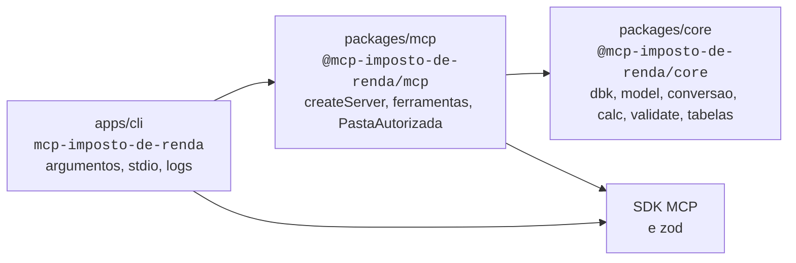
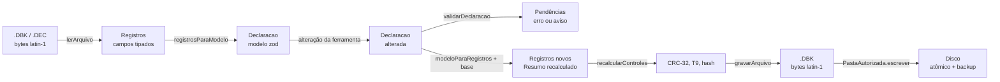
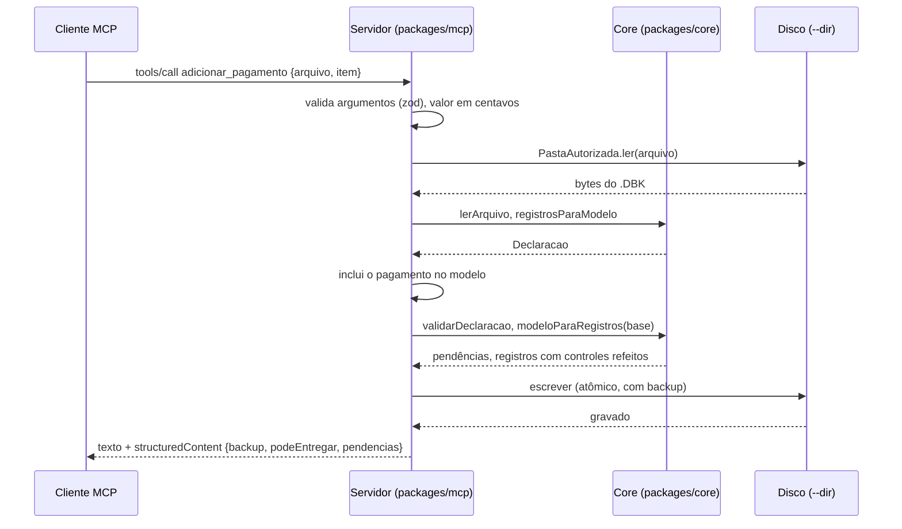
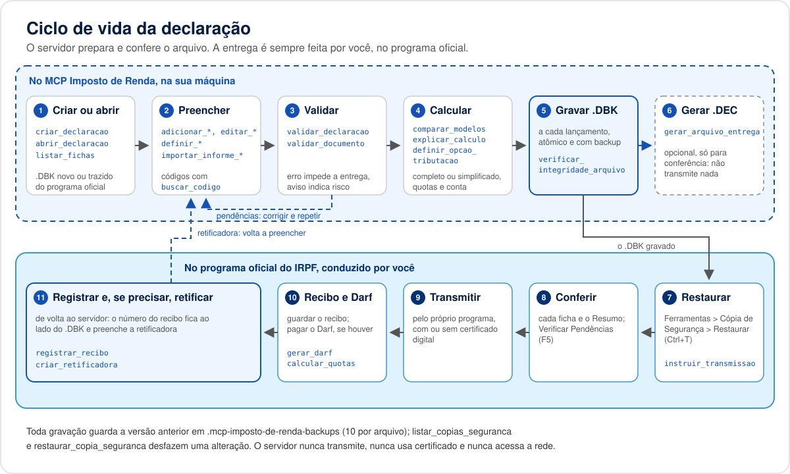

# Arquitetura

Como o MCP Imposto de Renda é montado por dentro: pacotes, fluxo de dados, codec do arquivo,
modelo, motor de cálculo, validações, camada de arquivos e o registro das ferramentas. Para o
passo a passo de quem vai mexer no código (ambiente, exercício novo, convenções), veja o
[guia de desenvolvimento](guias/desenvolvimento.md). Vocabulário do domínio em
[CONTEXT.md](../CONTEXT.md).

## Sumário

- [Visão geral](#visão-geral)
- [Pacotes e regra de dependência](#pacotes-e-regra-de-dependência)
- [Fluxo de dados](#fluxo-de-dados)
- [Codec do arquivo](#codec-do-arquivo)
- [Modelo da declaração](#modelo-da-declaração)
- [Conversão entre registros e modelo](#conversão-entre-registros-e-modelo)
- [Motor de cálculo](#motor-de-cálculo)
- [Validações](#validações)
- [Tabelas de códigos](#tabelas-de-códigos)
- [Camada de arquivos](#camada-de-arquivos)
- [Servidor e registro das ferramentas](#servidor-e-registro-das-ferramentas)
- [Uma sessão típica](#uma-sessão-típica)
- [Ciclo de vida da declaração](#ciclo-de-vida-da-declaração)
- [Executável](#executável)
- [Como a precisão é garantida](#como-a-precisão-é-garantida)
- [Ferramentas de apoio](#ferramentas-de-apoio)

## Visão geral


O servidor é um processo local que o cliente MCP inicia e encerra. Ele fala só por stdio, lê e
grava só dentro de uma pasta escolhida pelo usuário e não abre conexão de rede
([ADR 0001](adr/0001-mcp-local-sem-servidor.md)). O cálculo e o codec do arquivo são próprios, em
TypeScript, sem executar nem embutir o programa oficial
([ADR 0002](adr/0002-motor-de-calculo-proprio-sem-jar.md)).

Princípios que atravessam todas as camadas:

- **Núcleo puro.** Tudo o que é regra de negócio (formato do arquivo, modelo, cálculo, validação,
  tabelas) fica em `packages/core`, sem I/O. O mesmo código roda nos testes, no servidor e em
  qualquer outro consumidor.
- **Uma porta para o disco.** O servidor só toca no disco pela `PastaAutorizada`.
- **Dinheiro em centavos.** `bigint` no core, nunca ponto flutuante. Texto em reais só na borda.
- **Preservação.** O que o modelo não descreve continua no arquivo, byte a byte.
- **Sem dados pessoais em logs e erros.** Mensagens citam ficha e campo, nunca o conteúdo.

## Pacotes e regra de dependência



| Pacote | Pasta | Responsabilidade | I/O permitido |
| --- | --- | --- | --- |
| `mcp-imposto-de-renda` | `apps/cli` | Interpreta argumentos, confere a pasta, liga o transporte stdio, escreve logs em stderr e encerra com prazo para as chamadas pendentes. | Processo e stdio. |
| `@mcp-imposto-de-renda/mcp` | `packages/mcp` | `createServer()`: grupos de ferramentas, prompts, recursos, esquemas de entrada, mensagens de erro e a `PastaAutorizada`. | Disco, só pela `PastaAutorizada`. Nunca rede. |
| `@mcp-imposto-de-renda/core` | `packages/core` | Codec do arquivo, modelo tipado, conversão, motor de cálculo por exercício, regras de validação e tabelas de códigos. | Nenhum. Funções puras sobre bytes e objetos. |

A dependência só vai de fora para dentro. O core não conhece o MCP, e o servidor não conhece o
transporte: `createServer` devolve o `McpServer` sem conectá-lo, e quem chama decide (stdio no CLI,
transporte em memória nos testes e nos [exemplos](../exemplos/README.md)). Um teste automatizado
confere que nem o servidor nem o CLI importam `http`, `https`, `net`, `tls`, `dns` ou
`child_process`, nem usam `fetch` ([segurança](seguranca.md)).

## Fluxo de dados

Toda ferramenta que mexe numa declaração percorre o mesmo caminho, dos bytes ao modelo e de volta:



1. **Leitura.** `PastaAutorizada.ler` devolve os bytes; `lerArquivo` separa as linhas e decodifica
   cada registro pelo leiaute do exercício.
2. **Interpretação.** `registrosParaModelo` monta o objeto da declaração a partir dos 57 tipos de
   registro cobertos; `interpretarDeclaracao` o valida com o esquema zod e devolve mensagens
   pensadas para o modelo de linguagem corrigir a chamada.
3. **Alteração.** A ferramenta trabalha numa cópia profunda do modelo.
4. **Validação.** `validarDeclaracao` aplica as 108 regras. A gravação não é bloqueada por
   pendências, para permitir preencher aos poucos; elas voltam sempre na resposta, com
   `podeEntregar`.
5. **Geração.** `modeloParaRegistros` gera os registros a partir do modelo, pareando cada um com o
   registro original (a *base*), recalcula os totais do Resumo com o motor e refaz os controles.
6. **Conferência e gravação.** Os bytes gerados são relidos e os controles conferidos antes de ir
   ao disco; a escrita é atômica e guarda o conteúdo anterior.

As ferramentas de cálculo do grupo `calculo` e as calculadoras não leem arquivo: recebem os dados
na própria chamada e vão direto ao motor.

## Codec do arquivo

`packages/core/src/dbk/`. Descrição completa do formato em [formato-dbk.md](formato-dbk.md).


| Módulo | Papel |
| --- | --- |
| `leiautes/2026.ts` | Leiaute do exercício, gerado por `tools/leiaute` a partir dos XML de dados do programa (posições, tamanhos, formatos e casas decimais de cada campo), com o SHA-256 das fontes no cabeçalho. |
| `leiaute.ts` | Acesso ao leiaute: tipo de registro pelos primeiros caracteres da linha, campos por tipo. |
| `codec.ts` | `lerArquivo` e `gravarArquivo`: texto ISO-8859-1, uma linha por registro, CRLF, campos de posição fixa. Formato `N` vira `bigint` com casas implícitas; datas ficam em `DDMMAAAA`; campo em branco vira `null`. |
| `controle.ts` | Os quatro controles de integridade: CRC-32 de cada registro (`NR_CONTROLE`), controle do header, contagens do `T9` e `NR_HASH`. `verificarControles` confere, `recalcularControles` refaz. |
| `recibo.ts` | Monta o recibo (`HR`, `DR`, `R9`) para gerar o `.DEC` a partir do `.DBK`, como o programa grava. |
| `erros.ts` | Erros do codec com o tipo do registro e a posição, sem o conteúdo da linha. |

O codec é genérico: não sabe o que é um dependente ou um bem. Ele garante que qualquer arquivo
gravado pelo programa oficial seja relido e regravado **byte a byte**, o que a suíte confere nos
96 arquivos de referência (48 `.DBK` e 48 `.DEC`).

## Modelo da declaração

`packages/core/src/model/`. A representação canônica entre o codec, o motor, as validações e as
ferramentas.

- Cada ficha é um esquema zod (`zIdentificacao`, `zDependente`, `zRendimentoPJ`, `zBem` e assim por
  diante); `zDeclaracao` agrega as 26 fichas do exercício.
- Valores monetários são `Centavos` (`bigint`), datas `AAAA-MM-DD`, CPF e CNPJ só com dígitos.
- Uniões discriminadas expressam as variantes do programa: o código do rendimento isento decide os
  campos do item, o beneficiário é `titular` ou `dependente` com CPF, o endereço é no Brasil ou no
  exterior.
- O mesmo esquema serve de contrato JSON para quem chama: `converter_dbk_para_modelo` devolve esse
  formato e `converter_modelo_para_dbk` o aceita. As descrições dos campos das ferramentas de
  edição são geradas a partir dele.

## Conversão entre registros e modelo

`packages/core/src/conversao/`.

- `registrosParaModelo(registros)` lê as fichas cobertas por mapeadores por assunto
  (`mapeadores/identificacao.ts`, `rendimentos.ts`, `bens-dividas.ts`, `renda-variavel.ts`,
  `atividade-rural.ts`, `ganhos-capital.ts` e outros) e informa os tipos de registro que não
  conhece.
- `modeloParaRegistros(declaracao, { base })` faz o caminho inverso. Com a base, cada registro
  gerado é pareado com o original: o que o modelo descreve vem do modelo; fillers, campos que o
  modelo não guarda e registros de tipos não mapeados são preservados sem alteração.
- `recalculo.ts` traduz o modelo para a entrada do motor e devolve os campos do Resumo (registros
  17 a 20 e header) que o servidor sabe refazer. Os demais ficam como estavam na base e estão
  listados em `CAMPOS_NAO_RECALCULADOS`.

A cobertura por tipo de registro está em `COBERTURA_REGISTROS` e na tabela de
[formato-dbk.md](formato-dbk.md).

## Motor de cálculo

`packages/core/src/calc/`. Regras e fontes legais em [regras/irpf-2026.md](regras/irpf-2026.md).

- Um motor por exercício (`calc/2026/`), registrado em `motores` e obtido com
  `obterMotor(exercicio)`. Um exercício novo é uma pasta nova com a mesma interface.
- Puro e determinístico: recebe a entrada no formato dos casos de referência e devolve o Resumo nos
  dois modelos, completo e simplificado, com o mais vantajoso e a **memória de cálculo linha a
  linha**, cada linha com a conta feita e a regra aplicada. `explicar_calculo` devolve essa memória
  sem reformatar.
- Toda a aritmética usa `calc/aritmetica.ts` sobre centavos. O programa oficial trunca a fração de
  centavo das alíquotas, do desconto simplificado e do limite de 12%; o motor faz o mesmo,
  confirmado pelos casos de referência.
- `quotas.ts` divide o saldo em até 8 quotas com vencimentos e juros Selic; `datas.ts` cuida de dias
  úteis e prazos. As calculadoras auxiliares (carnê-leão, RRA, ganho de capital, renda variável)
  ficam em `packages/mcp/src/calculadoras/`.

## Validações

`packages/core/src/validate/`.

- `validarDeclaracao(declaracao)` devolve a lista de pendências em ordem de ficha. Cada pendência
  tem código, gravidade (`erro` impede a entrega, `aviso` indica risco de malha fina), ficha,
  caminho do campo e mensagem em pt-BR.
- As regras ficam em `regras/` por assunto (identificação, pessoas, rendimentos, pagamentos e
  doações, bens e dívidas, demonstrativos, casos especiais, Resumo) e entram no catálogo `REGRAS`:
  **108 regras, 81 de erro e 27 de aviso**, cada uma com descrição e fonte.
- `documento.ts` confere os dígitos de CPF e CNPJ; `conta-bancaria.ts` aplica o cálculo público do
  DV da conta de cada banco.

## Tabelas de códigos

`packages/core/src/tabelas/`. As **32 tabelas** do exercício (dependentes, pagamentos, bens e
direitos, municípios, países, bancos, fundos da criança e da pessoa idosa, entre outras) vêm dos
JSON de [mapeamento/tabelas](mapeamento/tabelas/README.md), extraídos dos XML de dados do programa.
`listar(tabela)` devolve as entradas na ordem original e `buscarCodigo(tabela, codigo)` consulta com
índice em memória. As ferramentas `listar_tabela` e `buscar_codigo` expõem essa API e
`verificar_versao_tabelas` informa de qual versão do programa elas vieram.

## Camada de arquivos

`packages/mcp/src/arquivos/`. A `PastaAutorizada`, criada a partir de `--dir`, é a única porta do
servidor para o disco, e as regras valem para qualquer ferramenta presente ou futura:

| Proteção | Como |
| --- | --- |
| Contenção | Só nomes relativos. Caminho absoluto, `..`, barra invertida, bytes de controle, segmentos ocultos e nomes reservados do Windows são recusados antes de tocar no disco. |
| Links | Links simbólicos não são seguidos, nem no arquivo final nem em pastas intermediárias (conferido com `realpath`). |
| Extensões | Cada ferramenta declara as que aceita (`.DBK`, `.DEC`, `.json`, `.txt`); a gravação de declaração só gera `.DBK`. |
| Limites | 20 MB por arquivo lido ou gravado e 50.000 elementos por chamada. |
| Escrita atômica | Arquivo temporário na mesma pasta, `fsync` e `rename`. |
| Cópias de segurança | Antes de sobrescrever ou excluir, cópia com carimbo de data em `.mcp-imposto-de-renda-backups`, permissão 0600 e rotação de 10 por arquivo. |
| Mensagens | Erros citam só o nome relativo informado, nunca o caminho absoluto da máquina. |

A pasta é aberta na primeira utilização (`pastaSobDemanda`), o que mantém `createServer` síncrono.
Modelo de ameaças completo em [seguranca.md](seguranca.md).


## Servidor e registro das ferramentas

`packages/mcp/src/`.


As 162 ferramentas estão em 11 grupos. Cada grupo é um módulo em `ferramentas/` que exporta um
`GrupoFerramentas` e entra na lista `GRUPOS` de `ferramentas/registro.ts`; a ordem da lista é a
ordem do `tools/list`.

```ts
// ferramentas/tipos.ts (resumo)
interface GrupoFerramentas {
  nome: NomeGrupo;
  descricao: string;
  exigePasta?: boolean; // sem --dir, o grupo não é registrado
  registrar(registro: RegistroFerramentas): void;
}

registro.ferramenta("simular_imposto", {
  titulo: "Simular imposto do exercício",
  descricao: "...",
  entrada: zEntradaCalculo.shape, // esquema zod; vira o inputSchema
  saida: { ... },                 // vira o outputSchema
  escreve: false,                 // true: anotações de escrita e some com --somente-leitura
}, async (args) => ({ texto, dados }));
```

O `RegistroFerramentas` (`ferramentas/registrador.ts`) faz o que é comum a todas:

- **Anotações.** Leitura: `readOnlyHint: true`, `idempotentHint: true`. Escrita:
  `destructiveHint: true`, para o cliente pedir confirmação. Todas: `openWorldHint: false`.
- **Somente leitura.** Ferramentas com `escreve: true` não são registradas quando o servidor sobe
  com `--somente-leitura` (restam 59).
- **Perfis e grupos.** `ferramentas/perfis.ts` define recortes do catálogo para clientes que
  limitam a quantidade de ferramentas: `essencial` (78, sem os atalhos por ficha e sem as
  calculadoras) e `consulta` (37, só leitura e cálculo). O CLI escolhe com `--perfil`, `--grupos` e
  `--sem-grupos`.
- **Resposta dupla.** Texto legível em pt-BR mais `structuredContent` validado pelo `outputSchema`.
  Dados vindos de arquivo ou de texto colado pelo usuário vão dentro de um bloco
  `<dados_do_arquivo>` marcado como dado, não instrução.
- **Erros.** Qualquer exceção vira `isError: true` com mensagem fixa por tipo de falha
  (`erros.ts`), sem stack trace, caminho absoluto ou conteúdo da declaração.
- **Valores monetários.** `zValorMonetario` aceita texto em reais (`"1.234,56"`) ou inteiro em
  centavos e normaliza para centavos antes de chegar à ferramenta.

Além das ferramentas, `prompts.ts` registra os roteiros `preparar_declaracao` e
`revisar_malha_fina`, e `recursos.ts` publica o aviso legal em `mcp-imposto-de-renda://aviso-legal`.
A referência completa, com parâmetros e exemplos reais, está em
[ferramentas/README.md](ferramentas/README.md).

## Uma sessão típica


O mesmo fluxo em texto, para a inclusão de uma despesa médica:



## Ciclo de vida da declaração



| Etapa | Onde | Ferramentas |
| --- | --- | --- |
| 1. Criar ou abrir | servidor | `criar_declaracao`, `abrir_declaracao`, `listar_arquivos`, `listar_fichas` |
| 2. Preencher | servidor | grupo `edicao`, `importar_informe_rendimentos`, `importar_informe_plano_saude`, `buscar_codigo` |
| 3. Validar | servidor | `validar_declaracao`, `validar_documento` |
| 4. Calcular | servidor | `simular_imposto`, `comparar_modelos`, `explicar_calculo`, `definir_opcao_tributacao`, `definir_informacoes_bancarias` |
| 5. Gravar `.DBK` | servidor | automático a cada lançamento; `verificar_integridade_arquivo`, `gerar_relatorio_declaracao` |
| 6. Gerar `.DEC` (opcional) | servidor | `gerar_arquivo_entrega`, só para conferência |
| 7 a 10. Restaurar, conferir, transmitir, guardar o recibo | programa oficial | `instruir_transmissao` orienta; `gerar_darf` e `calcular_quotas` ajudam no pagamento |
| 11. Registrar e retificar | servidor | `registrar_recibo`, `criar_retificadora` |

Qualquer gravação pode ser desfeita com `listar_copias_seguranca` e `restaurar_copia_seguranca`.
As [declarações de exemplo](../exemplos/README.md) percorrem esse ciclo de ponta a ponta.

## Executável

`apps/cli/`. `mcp-imposto-de-renda --dir <pasta> [--somente-leitura]`.

- `args.ts` interpreta os argumentos e confere a pasta antes de subir: precisa existir, ser
  diretório e ter permissão de leitura (e de gravação, se não for somente leitura).
- `index.ts` cria o servidor, liga o `StdioServerTransport` e reserva o stdout para o protocolo.
  Logs vão para stderr e levam só eventos do processo, nome da ferramenta e classe do erro.
- No encerramento, espera até 30 segundos pelas chamadas em andamento antes de sair.
- O pacote publicado traz só o executável, com os pacotes do workspace embutidos pelo `tsup`.

## Como a precisão é garantida


| Garantia | Evidência |
| --- | --- |
| O motor reproduz o programa oficial ao centavo | 65 casos de referência (golden) em `packages/core/test/golden/2026` |
| O codec relê e regrava os arquivos do programa byte a byte | 96 arquivos em `packages/core/test/fixtures/dbk/2026`, e cada `.DBK` vira o mesmo `.DEC` que o programa grava |
| O codec resiste a entradas aleatórias e hostis | testes de propriedades e de integridade em `packages/core/test` |
| O servidor não acessa a rede e não sai da pasta | `packages/mcp/test/seguranca.test.ts` e `arquivos.test.ts` |
| Os exemplos e a documentação refletem o código | `exemplos/exemplos.test.ts`, `pnpm docs:catalogo` e `pnpm docs:links` |

Detalhes da estratégia de testes em [testes.md](testes.md).

## Ferramentas de apoio

| Pasta | O que faz |
| --- | --- |
| `tools/leiaute` | Gera `packages/core/src/dbk/leiautes/<exercício>.ts` a partir dos XML de dados do programa. |
| `tools/referencia` | Harness local que usa o programa oficial, baixado por você e nunca versionado, para gerar os casos golden e os arquivos de referência ([README](../tools/referencia/README.md)). |
| `tools/mapeamento` | Inventário das funções do programa e a [matriz de cobertura](mapeamento/matriz-cobertura.md). |
| `tools/docs` | Gera o catálogo do README e a [referência das ferramentas](ferramentas/README.md) a partir do `tools/list` real, e confere links da documentação. |
