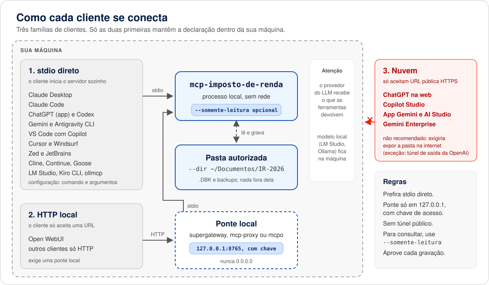

# Configuração nos clientes MCP

O MCP Imposto de Renda é um servidor MCP **local, só por stdio**: o cliente inicia o processo na sua
máquina, passa a pasta da declaração em `--dir` e conversa com ele pela entrada e saída padrão. Não
há modo HTTP ([ADR 0001](../adr/0001-mcp-local-sem-servidor.md)).

## Clientes

Níveis de suporte: **completo** (o cliente inicia o servidor por stdio), **com ponte** (o cliente só
aceita URL e precisa de uma [ponte local](clientes/ponte-stdio-http.md) em `127.0.0.1`) e **não
suportado** (o cliente roda na nuvem e exigiria expor a pasta na internet).

| Cliente | Transporte suportado | Suporte | Plano | Guia |
| --- | --- | --- | --- | --- |
| Claude Desktop | stdio | Completo | Qualquer conta Claude | [claude-desktop.md](clientes/claude-desktop.md) |
| Claude Code (CLI, IDE e desktop) | stdio, HTTP | Completo | Pro, Max, Team, Enterprise ou chave de API | [claude-code.md](clientes/claude-code.md) |
| ChatGPT, aplicativo de desktop (Codex) | stdio | Completo | Conta com acesso ao Codex | [chatgpt.md](clientes/chatgpt.md) |
| ChatGPT na web | HTTPS público ou Secure MCP Tunnel | Com ponte, não recomendado | Conforme plano e workspace | [chatgpt.md](clientes/chatgpt.md#chatgpt-na-web) |
| OpenAI Codex CLI e extensão de IDE | stdio, HTTP | Completo | Conta com Codex ou chave de API | [codex.md](clientes/codex.md) |
| Gemini CLI | stdio, HTTP, SSE | Completo | Chave paga ou licença empresarial (contas pessoais migraram em 18/06/2026) | [gemini-cli.md](clientes/gemini-cli.md) |
| Antigravity CLI, app e IDE | stdio, HTTP, SSE | Completo | Conta Antigravity | [gemini-cli.md](clientes/gemini-cli.md#antigravity-cli) |
| App Gemini e Google AI Studio | sem servidor local | Não suportado | Qualquer | [gemini-app-e-ai-studio.md](clientes/gemini-app-e-ai-studio.md) |
| Gemini Enterprise | Streamable HTTP com TLS público | Não suportado | Edições pagas | [gemini-app-e-ai-studio.md](clientes/gemini-app-e-ai-studio.md) |
| GitHub Copilot no VS Code | stdio, HTTP | Completo com `--perfil essencial` (limite de 128 ferramentas) | Qualquer plano do Copilot | [vscode-copilot.md](clientes/vscode-copilot.md) |
| Cursor | stdio, SSE, HTTP | Completo | Qualquer plano | [cursor.md](clientes/cursor.md) |
| Windsurf (Devin Desktop) | stdio, HTTP, SSE | Completo com `--perfil essencial` (limite de 100 ferramentas no Cascade) | Qualquer plano | [windsurf.md](clientes/windsurf.md) |
| Zed | stdio, HTTP | Completo (sem recursos MCP) | Gratuito ou plano do Zed | [zed.md](clientes/zed.md) |
| JetBrains AI Assistant e Junie | stdio, HTTP, SSE | Completo | Acesso ao JetBrains AI | [jetbrains.md](clientes/jetbrains.md) |
| Cline | stdio, HTTP, SSE | Completo | Gratuito (paga o modelo) | [cline.md](clientes/cline.md) |
| Roo Code | stdio, HTTP, SSE | Completo, projeto descontinuado | Gratuito (paga o modelo) | [roo-code.md](clientes/roo-code.md) |
| Continue | stdio, HTTP, SSE | Completo (modo agente) | Gratuito (paga o modelo) | [continue.md](clientes/continue.md) |
| goose | stdio, HTTP | Completo | Gratuito | [goose.md](clientes/goose.md) |
| LM Studio | stdio, HTTP | Completo, modelo local | Gratuito | [lm-studio.md](clientes/lm-studio.md) |
| Ollama | não é cliente MCP | Completo via ollmcp, goose, Continue ou Cline | Gratuito | [ollama.md](clientes/ollama.md) |
| Open WebUI | Streamable HTTP; OpenAPI via mcpo | Com ponte | Gratuito (admin adiciona) | [open-webui.md](clientes/open-webui.md) |
| Microsoft Copilot Studio | Streamable HTTP pela nuvem | Não suportado | Licença organizacional | [copilot-studio.md](clientes/copilot-studio.md) |
| Kiro CLI (antigo Amazon Q Developer CLI) | stdio, HTTP | Completo | Conta Kiro | [kiro-amazon-q.md](clientes/kiro-amazon-q.md) |

Os dados de cada linha foram conferidos na documentação oficial de cada cliente em 14/10/2026; cada
guia traz no rodapé as URLs consultadas. Planos e telas mudam com frequência: em caso de divergência,
vale a documentação do fornecedor.

## O que todo cliente precisa

| Instalação | `command` | `args` |
| --- | --- | --- |
| npm (depois da publicação) | `npx` | `["-y", "mcp-imposto-de-renda", "--dir", "<pasta>"]` |
| código-fonte (hoje) | `node` | `["/caminho/para/mcp-imposto-de-renda/apps/cli/dist/index.js", "--dir", "<pasta>"]` |

O pacote ainda não está publicado no npm. Até lá, compile a partir do código
([instalação](instalacao.md)) e use a segunda linha. Para escolher quais ferramentas o cliente vê,
acrescente `"--perfil", "<nome>"` ao fim de `args` (veja abaixo). Para só consultar e simular,
`"--perfil", "consulta"` ou `"--somente-leitura"`.

Nos exemplos dos guias, troque `/Users/voce/Documentos/IR-2026` pela sua pasta. No Windows, use barras
normais (`"C:/Users/voce/Documentos/IR-2026"`) ou duplas (`"C:\\Users\\voce\\Documentos\\IR-2026"`) no
JSON.

## Quantidade de ferramentas

O servidor completo registra **166 ferramentas** (100 gravam). Alguns clientes limitam a lista: o VS
Code aceita até 128 ferramentas por pedido e o Cascade do Windsurf, 100. Modelos locais também sofrem
com listas longas. Para isso existem os perfis, escolhidos com `--perfil <nome>` ou com a variável de
ambiente `MCP_IMPOSTO_DE_RENDA_PERFIL` (a opção na linha de comando vale mais):

| Perfil | Ferramentas | O que expõe | Quando usar |
| --- | --- | --- | --- |
| `completo` (padrão) | 166 | Tudo. | Clientes sem limite (Claude Code, Claude Desktop, Cursor, Codex e outros). |
| `essencial` | 90 | O ciclo inteiro: criar, preencher qualquer ficha, validar, calcular e gravar. Ficam de fora os atalhos repetidos por ficha (`editar_*`, `remover_*` e `listar_*` de cada ficha, cobertos por `editar_lancamento`, `remover_lancamento` e `listar_lancamentos`) e as 10 calculadoras avulsas. | VS Code (128), Windsurf (100) e modelos locais que vão gravar. |
| `consulta` | 44 | Só leitura e cálculo; nenhuma ferramenta grava. Dispensa pasta com permissão de gravação. | Simular, validar e revisar sem risco. |

Para ajuste fino, `--grupos calculo,validacao` expõe só os grupos citados e `--sem-grupos
calculadoras,orientacao` tira grupos; as duas opções combinam com `--perfil` e com
`--somente-leitura`. `mcp-imposto-de-renda --ajuda` mostra a contagem de cada perfil e de cada grupo,
e o log de início diz quantas ferramentas ficaram (`pronto (versão 0.1.0, perfil essencial, 90
ferramentas)`). Nome de perfil ou de grupo inválido encerra com código 2 e uma mensagem que lista os
nomes válidos.

## Boas práticas

- **Confirmação antes de gravar.** Deixe o cliente pedir aprovação para ferramentas com
  `destructiveHint: true` (inclusão, alteração, remoção e gravação do `.DBK`). Não use aprovação
  automática para este servidor.
- **Um servidor por pasta.** Para separar declarações de pessoas diferentes, configure dois
  servidores com nomes distintos (`mcp-imposto-de-renda-ana`, `mcp-imposto-de-renda-bruno`), cada um
  com a sua pasta.
- **Configuração pessoal fora do git.** Arquivos de projeto (`.mcp.json`, `.cursor/mcp.json`,
  `.vscode/mcp.json` e semelhantes) levam o caminho da sua pasta; prefira o escopo de usuário.
- **Ponte só em 127.0.0.1.** Se precisar de HTTP, siga a [ponte local](clientes/ponte-stdio-http.md).
- **Privacidade.** O provedor de LLM configurado no cliente recebe tudo o que as ferramentas
  devolvem. Com modelo local ([LM Studio](clientes/lm-studio.md), [Ollama](clientes/ollama.md)), nada
  sai da máquina.

## Prompt para começar em qualquer cliente

> Use o MCP Imposto de Renda para criar minha declaração 2026 a partir destes informes de rendimentos.
> Liste os arquivos da pasta autorizada, abra o DBK que gravei no programa oficial, mostre o que vai
> preencher em cada ficha e só grave depois da minha confirmação.

Problemas comuns (comando `npx` não encontrado no Windows, caminho com espaços, servidor que não
aparece) estão em [solucao-de-problemas.md](solucao-de-problemas.md).
